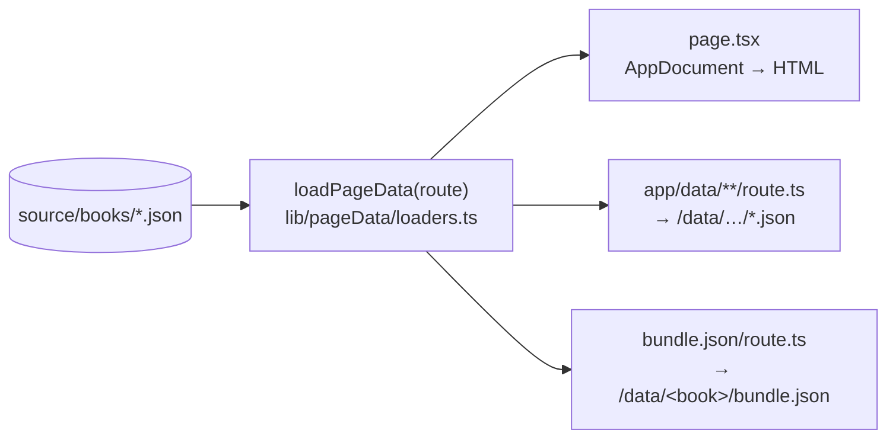
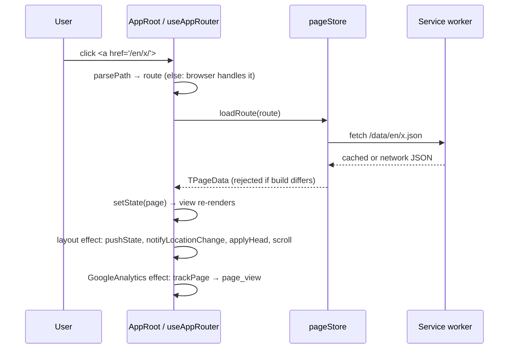

# App architecture: static HTML + JSON navigation

The site is a Next.js **static export** (`output: 'export'`, `trailingSlash: true`) that behaves like a single-page app after the first load.

- **Crawlers and first visits** get a fully prerendered HTML page per URL, with full content, metadata and JSON-LD.
- **Every later navigation** fetches a small JSON file with that page's data and renders it on the client. There is no document reload and no Next RSC request.
- **What survives navigation:** the shell (header, footer, hotkeys, analytics) and the audio player.
- **Offline:** a whole songbook can be cached by the service worker.

Route-by-route details, and how to add a route, are in `app-routes.instructions.md`. Plan and measurements: `.github/plans/plan-improved-js-app.md`.

## The core idea: one loader, two outputs



Each page's data is built **once, by one function**, at build time:

- The HTML route embeds it as the initial props of `AppRoot`.
- The JSON route writes the identical object to `/data/…`.
- The bundle route concatenates all JSON files of a book.

Because all three come from `loadPageData`, the first render and a client navigation to the same URL are guaranteed to show the same thing.

`loadPageData` is **React-free** and does all server-only work: filesystem reads, markdown → HTML, metadata, audio scans. Views receive plain serializable data only.

## Page data contract — `types/pageData.ts`

```ts
TRoute      // what to load: { kind, bookId, slug? | singerId? }; songs and markdown pages share kind 'item'
TPageData   // what was loaded: { build, kind, route, head, data }, discriminated by kind
```

| Field | Meaning |
|---|---|
| `build` | `getBuildId()` = `<commit>@<builtTime>` (`other/router/buildId.ts`). The client rejects data from another build. |
| `kind` | `book-list`, `other`, `contents`, `a-z`, `authors`, `search`, `audio`, `audio-singer`, `song`, `page` |
| `route` | The route it answers. Narrowed per kind, e.g. a song has `route.slug`. |
| `head` | `title`, `description`, `canonical`: what the client applies to `<head>` after navigation. Taken from the same `other/metadata/*` builders as `generateMetadata`. |
| `data` | The view's props: `TIndexData`, `TSongData`, `TPageItemData`, … |

`TPageDataOf<'song'>` picks one kind. `TBookBundle` = `{ assets, build, pages: { [dataUrl]: TPageData } }`. `assets` lists the files the service worker caches with the book, because it cannot list directories. All paths are site-relative and sorted:

- `bookImages`: every file in `public/images/cover` and `public/images/thumbnail` (all songbooks, both densities).
- `contentImages`: the `/images/resources/**` images of the book's songs and pages, from `source/books/<book>/content-images.json`. `install:post-fetch` writes it (`transformContents`: song head image + resources-repo images in verse translations and page bodies), using the same link pattern as the loaders (`scripts/resourceImageUrls.js`).
- `shell`: the files in `public/images/svg` (logo).

## Build output (`next build` → `out/`)

| Output | Produced by |
|---|---|
| `/<book>/…/index.html` for every reader page | `app/[bookId]/**/page.tsx` → `loadPageData` → `<AppDocument page extras>` |
| `/data/<book>/<file>.json` | `app/data/[bookId]/[file]/route.ts` (root pages, songs, pages) |
| `/data/<book>/audio/<file>.json` | `app/data/[bookId]/audio/[file]/route.ts` (audio index, singers) |
| `/data/<book>/bundle.json` | `app/data/[bookId]/bundle.json/route.ts` |
| `/index.html` (root page) | `app/page.tsx`: the songbook list of the first songbook (`getFirstBookId`), same page data and head as `/<firstBook>/` (so its canonical is `/<firstBook>/`), plus the inline script of `getRootPendingScript` in `<head>` |
| `/shell/index.html` | `app/shell/page.tsx`: `AppDocument` with `page={null}` (offline fallback) |
| `/<book>/<slug>.html` legacy redirects, `.nojekyll` | `scripts/postbuild.js` (unchanged) |
| `sitemap.xml`, `robots.txt`, `manifest.json`, `404.html` | Next metadata routes / `global-not-found.tsx` (unchanged) |

JSON route handlers are static (`dynamic = 'force-static'`). `generateStaticParams` must return a `file` value that **ends in `.json`**, because the exported file is named after the route path. Next also writes RSC `.txt` files next to every HTML page; nothing uses them.

## Runtime



### Document and app root

- `components/app/AppDocument.tsx` (server): `<html lang>`, `DocumentHead`, `<body>` with `AppRoot`.
- `components/app/AppRoot.tsx` (client): holds the current page via `useAppRouter`. It renders:
  - `LayoutChrome {...getChrome(page)}` (header, `<main>`, footer, GA, service worker registration, hotkeys) — **persistent**. Header, `<main>` and footer are all inside the scroller `.Layout__content` (footer positioning: `player-widget.instructions.md`, "Dock layout contract").
  - `PagePathContext` + `renderView(page, extras)` — the view, **keyed by path**, so it remounts per page.
  - `PlayerDock` — **persistent**, so playback survives navigation.
- `components/app/views/registry.ts`:
  - `VIEWS` maps each kind to a view component.
  - `renderView` builds the view element.
  - `getChrome` gives the layout props per kind: `<main>` class, footer page number, analytics `pageType`/`itemId`.
- **`extras`** is server-rendered content that can't come from JSON (JSON-LD). It is shown only while the initial page is displayed (`isInitialPage`); crawlers never navigate client-side.

### Router — `other/router/`

| File | Role |
|---|---|
| `routes.ts` | URL ↔ route ↔ data URL. `parsePath(pathname)` returns `null` for non-app paths (analyze, export, test, shell, files, `.html`); `/` is the songbook list of the first songbook (`__BOOK_IDS__[0]`). `getRoutePath`, `getRouteDataUrl`, `getRouteFile`, `parseItemFile`, `parseAudioFile`, `getBookBundleUrl`, `SHELL_PATH`. |
| `pageStore.ts` | `loadRoute` (memory cache + in-flight dedupe, rejects on 404 or a build mismatch), `prefetchRoute`, `seedRoute`. Cache and prefetch are **off in development**. |
| `navigate.ts` | `navigate(href)`: programmatic navigation. Falls back to `location.assign` outside the app or for non-app paths. |
| `location.ts` | `useAppLocation()` (`{ pathname, search }`, `null` while hydrating) and `notifyLocationChange()`. |
| `useAppRouter.ts` | Click interception, back/forward, per-entry scroll memory (`__kirtanKey` in `history.state`), loading flag, full-load fallback, neighbour prefetch. |
| `head.ts` | `applyHead(page)`: `document.title`, meta description, canonical, `<html lang>`. |
| `pagePath.ts` | `PagePathContext`: path of the rendered view. Needed because the new view renders **before** the URL changes. |
| `precache.ts` | `usePrecacheBook(bookId)` — see Offline. |
| `buildId.ts` | `getBuildId()` |

How links behave:

- **Clicks:** one delegated `click` listener on `document`. Any same-origin `<a href>` whose path parses is intercepted. Modifier keys, `target`, `download`, plain in-page `#hash` anchors and non-app paths are left to the browser.
- **Programmatic navigation** (hotkeys, swipe, search auto-jump) calls `navigate()`. Never set `window.location.href` for an internal page.
- **Same path, different query** (`?p=`): `pushState` only, no fetch. `useAppLocation` consumers (`usePageQuery`, `FooterItem`) update.
- **Fallback to a full document load** on: fetch error, missing JSON (→ static 404), data from another build (new deploy), or a non-app path.
- **History entries carry `{ __kirtanKey }`.** Next's patched `pushState` adds its own keys and keeps `usePathname` in sync. Don't spread `history.state` into a pushed entry.
- **Loading bar:** after 150 ms a 3px top bar (`AppRoot__progress`) appears.

### Things that persist across navigation

- **Player:** one `PlayerDock` in `AppRoot`. `PlayerManager` keeps a queue: the live DOM order while the active widget is on screen, and a frozen, kept-alive queue after its page is left. See `player-widget.instructions.md`.
- **Analytics:** `GoogleAnalytics` lives in `LayoutChrome`. Its effect calls `trackPage` when `bookId/itemId/pageType` change. After the first call, `trackPage` sends an explicit `page_view`; it runs after `applyHead`, so the new URL and title are already set. GA4 "page changes based on browser history events" should be **off**, or views count twice.
- **Hotkeys and footer** read the URL through `useAppLocation`, never `window.location` during render.

## Offline (service worker)

Full description: `offline-mode.instructions.md` (worker strategies, book job, status records, messages, status store, dot and popup, debugging). In short:

- **Registration:** `other/hooks/useServiceWorker.ts` registers `sw.js?v=<getBuildId()>`, so each build gets its own cache (`kirtan-<build>`). Dev registers no worker.
- **Shell:** `/shell/` is `AppDocument` with no data, cached when the worker installs. Served offline for an uncached URL, `useAppRouter` loads that URL's JSON (from the cache) and renders it. If that fails it shows "You're offline". Next keeps the real URL; it does not rewrite to `/shell/`.
- **Page data offline:** the worker answers `/data/<book>/<file>.json` from the book's cached `bundle.json`; the bundle is the store of a book's pages.
- **Precache:** `usePrecacheBook` (in `AppRoot`) asks the worker on idle to cache the book of the current page (bundle, shell files, covers, content images). The songbook list `/<book>/` starts no caching.
- **State:** `useBookCacheState(bookId)` and the header dot show whether a book is cached; `useIsOnline()` is the connectivity flag.

## Root page `/`

`/` is a real app page: its HTML is the songbook list of the first songbook, so crawlers get content and the installed app (`start_url: '/'`) has a start page. On start the app moves the reader to their own songbook, without a document load:

- **Pick** (`other/router/pickRootBookId.ts`): 1) the book chosen before (`PREFERENCES.PREFERRED_BOOK_ID` in `localStorage`), if it exists; 2) the main book in the browser language (`ua` is `uk`; variants such as `en-pe` are never picked); 3) the first book.
- **Move** (`useAppRouter`, `openRootBook`, on mount when the path is `/`): a `replace` navigation to `/<book>/`, query and hash kept. For the first book the page data is the one in the HTML (no request). For another book its `index.json` is loaded (from the cache when the book is cached). When that fails (offline, not cached) the first book stays and the URL becomes `/<firstBook>/`.
- **No flash:** the inline script in `<head>` (`getRootPendingScript`) runs the same pick before the first paint. It gets the rules as data (ids, language map), because it cannot import. When the pick is not the first book it sets `data-root-pending` on `<html>`; `AppRoot.scss` hides `.Layout` while it is set. The router removes it after the commit or on failure; the script removes it after 5 s in any case. `<html>` has `suppressHydrationWarning` for this attribute.
- **No in-app links to `/`.** The pick runs only on document load (mount). Client navigation to `/` shows the first book's list without the pick. Link to `getSongbookPath(bookId)` instead.
- **Offline:** the worker does not precache `/`. Without a cached `/` it serves `/shell/`, and the router runs the same pick there (`initial` is `null`): the reader's book, else the first book, else the "You're offline" note.

## What stays a plain document (no client navigation)

| Path | Why |
|---|---|
| `/<book>/analyze/`, `/<book>/export/` | Admin views. They use `Layout` or their own layout, not `AppDocument`; export must stay component-free. |
| `/test/**`, `/shell/` | Dev playgrounds / offline fallback |
| 404 (`global-not-found.tsx`) | Static; also redirects legacy `.html` URLs |
| `/<book>/<slug>.html` | Postbuild meta-refresh redirects |

## Development (`pnpm dev`)

- Pages and `/data/**` JSON render on demand from the same loaders.
- No page-data cache, no prefetch and no build-id check, so every navigation, including back, refetches fresh data.
- `generateStaticParams` is enforced per request (`output: 'export'`): a param not in the list returns 500. That is why the JSON handlers are split per book and by cost.
- Editing a loader after a client navigation makes Next refetch the current URL and remount `AppRoot`. The content is correct; view state and the player reset.
- StrictMode runs effects twice; router listeners and `usePlayer` teardown are written for that.
- Offline reloads can't be tested in dev: the cached page loads but never hydrates. Use a build (see Verifying a change).

## Rules (keep the architecture intact)

1. **Views get data, not loaders.** No `fs`, `lib/*` data functions, `marked` or `other/metadata/*` inside `components/app/views`, `components/content`, or anything they render. Add a field to the page data in `loadPageData` instead.
2. **Server-only markup** (JSON-LD) goes through `extras` from the route file.
3. **URLs** come from `other/paths.ts` (pages) and `other/router/routes.ts` (data). Keep the trailing slash.
4. **Navigation** uses `<a href>` (intercepted automatically) or `navigate()`. Never `router.push` or `window.location.href` for app pages.
5. **Current URL in components:** `useAppLocation()` / `usePageQuery()`. Inside a view, prefer the route from page data or `PagePathContext`.
6. **Keep `lib/content` handlers and `lib/export.ts` React-free.** The export page must not import views (their SCSS would leak into `export.html`).
7. A new page kind needs **all** touch points listed in `app-routes.instructions.md`. TypeScript (`VIEWS` mapped type, `switch` on `kind`) flags most missing ones.

## Verifying a change

```sh
pnpm run type-check && pnpm run lint
pnpm run build:local        # prints the route table: HTML routes and /data/ files
pnpm start                  # serve out/
```

- **Network panel:** clicking around shows only `/data/…json` requests (no Document, no `.txt`).
- **View source of a page:** full content, title, canonical, JSON-LD.
- **Offline:** build with `NEXT_PUBLIC_PREVENT_SERVICE_WORKER=false`, open a page, wait for the precache, stop the server, browse. E2E helpers for the cache (`waitForBookCached`, `ensureBookNow`, `getBookCacheStatus`, `getBookCacheInfo`, `listCachedPaths`, `deleteCached`, `recordRequests`) are in `tests/helpers/e2e.ts`.
