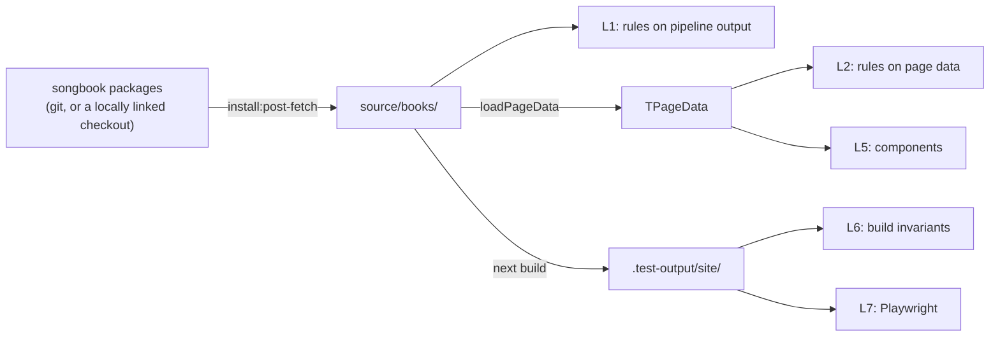

# Testing plan — part 1: main decisions

Date: 2026-11-15
Scope of this part: framework, test data, environment, where tests run, and how logic is split into test layers. Per-file test lists come in part 2, after these decisions are confirmed.

## Starting point

- No tests, no test tooling. Checks today: `type-check`, `lint`, `validation`, and manual / ad-hoc headless-Chrome scripts.
- Size of the logic: `scripts/` + `lib/` + `other/` + `public/sw.js` ≈ 7300 lines; `components/` = 94 `.tsx` files, ≈ 6700 lines.
- Things that make testing harder today:

| # | Obstacle | Where |
|---|---|---|
| O1 | Book data is not in the repo. `source/books/` is gitignored and built from 9 git-hosted packages (network + `pnpm run build` per book). It changes whenever a songbook changes. | `scripts/shared/*`, `.gitignore` |
| O2 | Data location is hard-coded: `process.cwd() + 'source/books'` in `lib/`, `__dirname/..` in `scripts/`. | 8 places in `lib/`, most of `scripts/` |
| O3 | Script entry files do their work on `require` (no exported function, no `require.main` guard). | `processSrc.js`, `validate.js`, `postbuild.js`, `createAllSongs.js`, `installShared.js`, `fetchTelegraphPages.js` |
| O4 | Scripts read config with a top-level `require('../source/songbooks.json')`. | `processSrc.js`, `songbookInfo.js`, `installShared.js` |
| O5 | Module-level caches (`booksMap`, …) and import-time env checks (`NEXT_PUBLIC_ORIGIN` throws). | `lib/books.ts`, `other/constants.ts` |
| O6 | Build-time global `__BUILD_INFO__` (webpack `DefinePlugin`). | `other/router/buildId.ts`, `other/displayVersion.ts` |
| O7 | The build writes to `out/`, which the developer's own `pnpm start` serves. | `next.config.ts`, `postbuild.js` |

## Decisions (summary)

| # | Topic | Decision | Main reason |
|---|---|---|---|
| D1 | Unit / data / component runner | **Vitest**, one config; projects are mapped to `tests/` folders | TS, JSX, `@/` alias, `define`, SCSS stubbing and CJS scripts all work with almost no config |
| D2 | Component tests | **React Testing Library** + `user-event`, in the `jsdom` project | The app has its own router and uses almost no Next runtime API, so components render without Next |
| D3 | Browser tests | **Playwright** against a static build served by `serve` | Router, history, scroll, service worker, offline, audio and touch need a real browser |
| D4 | Test data | **The real songbooks** in `source/books/`, the same ones dev and deploy use. No parallel fixture books | A schema change or a new feature reaches the tests with no fixture upkeep |
| D5 | Content drift | Tests never name a song or expect exact text. They pick songs **by feature** and assert rules. Cases the real books lack use small inline inputs | Real content changes independently of the code |
| D6 | Where tests run | **Both.** Local: Vitest in watch mode, Playwright on demand. GitHub: new `test.yml` on every push and pull request | Fast feedback locally; nothing unverified reaches deploy |
| D7 | Layers | Seven layers (L1–L7), each with one runner, one environment and one data source | A failure points at one layer; slow tests stay few |
| D8 | Code changes needed first | Three small seams (S1–S3), no behaviour change | Removes O3, O5–O7. O1, O2 and O4 stop mattering once tests use the real data |
| D9 | Folder structure | **Requirement.** All test code under `tests/`, one folder per layer, paths mirror the source, one folder for generated output. Enforced by a check | A test is found by its path; source folders and the repo root stay clean |

## D1–D3. Frameworks

### Vitest (L1–L6)

Compared options:

| Option | Verdict |
|---|---|
| **Vitest** | Chosen. |
| Jest + `next/jest` | Works, but more config (SWC transform, ESM deps, alias mapping) and slower watch mode. Its main benefit, mocking Next internals, is not needed: only `GoogleAnalytics.tsx` imports from `next/*`. |
| `node:test` | Fine for `scripts/`, but no JSX, alias or DOM story. Two runners would be needed. |

Config outline (`vitest.config.mts`):

- `resolve.alias` `@` → repo root (same as `tsconfig.json`).
- `define: { __BUILD_INFO__ }` with fixed values (O6).
- `test.env` from `env/.env.test` (O5).
- Projects are defined by folder, never by lists of files (see D9):
  - `node`: `tests/pipeline/`, `tests/data/`, `tests/logic/`.
  - `jsdom`: `tests/client/`, `tests/ui/`.
  - `build`: `tests/build/` (node; runs only in `pnpm test:build`).
- SCSS imports are stubbed by Vitest by default (`test.css`); no Sass run.
- Coverage: `v8` provider, reported per project.

Known limits to plan around:

- `vi.mock` does not intercept `require()` inside CommonJS files. `scripts/` tests therefore use **real files in a temp dir and function arguments**, not module mocks. This is why seam S1 is needed.
- `jsdom` has no layout, no media playback, no service worker and no real history scroll. Anything that depends on them goes to L7.

### Playwright (L7)

- Runs against a **test build of the real books** (`.test-output/site/`), served by `serve` on its own port (3337; 3333 and 3336 are in use by dev habits).
- Projects: `chromium` desktop (all tests) and `webkit` with an iPhone profile (smoke + touch swipe). Firefox is skipped.
- Replaces the ad-hoc raw-CDP scripts used so far for router, offline and player checks.
- Offline: `context.setOffline(true)` plus stopping the server for the service-worker tests.
- External services are never called: SoundCloud widget, audio file hosts, Google search API and Google Analytics requests are intercepted with `page.route` and answered with stubs (audio requests get one tiny silent file).
- Every test fails on an unexpected `console.error` or page error (catches hydration mismatches).
- Screenshot comparison is **postponed** (see Open questions): baselines differ between macOS and Linux.

## D4–D5. Test data

### Real songbooks, no fixture books



What this gives:

- A schema change or a new feature in a songbook reaches the tests by itself. Nothing is hand-edited.
- No extra setup: `source/books/` is already there for `pnpm dev`.
- A locally linked songbook (`pnpm add "<slug>@link:…"`) is tested before it is published.
- The tests also check the real content against the code, across all 9 books and 6 languages.

What it costs, and how each cost is handled:

| Cost | Handling |
|---|---|
| A content edit can break a test that names a song or expects exact text | Rules R1–R4 below |
| Some cases do not exist in the real books (broken input, rare combinations) | Small inline inputs, see below |
| No golden files or snapshots of content | Replaced by rules over all books, and by the L6 parity checks |
| CI must download and build 9 packages | Same steps as deploy already runs |
| A red run can be caused by a songbook edit, not by code | Accepted: the site would break the same way. The failure message names the book and the song. Pinning versions is possible later (Q1) |

### Rules for tests on real data

| # | Rule | Example |
|---|---|---|
| R1 | **No song slugs, titles or text in a test.** Book ids come from `getBookIdList()` or from a finder. | Not `loadPageData({ slug: 'akrodha-paramananda' })` |
| R2 | **Pick by feature.** `tests/helpers/cases.ts` holds named finders that search all books and return `{ bookId, slug }`. | `findSong('wbw-without-translation')`, `findSong('listed-twice-in-contents')`, `findBook('has-markdown-pages')` |
| R3 | **Assert rules, not values.** Expected values are computed from the data, not typed in. | "The view shows as many verses as the song data has"; "A–Z is sorted by `compareFirstLines`"; "every contents item points to an existing file" |
| R4 | **Sweep where it is cheap.** L1, L2 and L6 rules loop over every book and every song. L5 and L7 use one found song per case. | `loadPageData` succeeds and passes the page-data rules for every route |

If no real song matches a finder, the test **fails** with "no song covers case X". Coverage is never lost silently. The fix is an inline input, or dropping the case.

Finders to start with (the same list of cases as before, now as predicates):

- Author: `meta.author` present; only `author[0]`; no author.
- Contents: a song listed twice, several pages per song, alternative first lines, a markdown page item.
- A–Z: first line starting with a diacritic letter.
- Text: word-by-word present / absent, translation present / absent.
- Audio: no audio, one singer, several singers, SoundCloud source. No real song has a direct audio file today, so that source needs an inline input.
- Pages: markdown page with song references, page with images.
- Cross-book: same slug in several books, song in one book only, two books in one language.

### Inline inputs (the only hand-written data)

- **Tables** for pure functions (L3): input → expected, inside the test file.
- **Minimal objects** for cases the real books lack and for negative cases: one to three song or contents objects written in the test, saved to a temp dir when the function reads files. They are typed with the existing types (`types/song.ts`, `scripts/types.js`), so a schema change flags them at `type-check`.
- **Factories** (`tests/helpers/`) for objects that are tedious to write: `makePlayerTrack()`, `makeRoute()`.
- **Page data is never hand-written.** Component tests get it from `loadPageData(route)` on a real song picked by a finder, so props always match the real contract.
- **Snapshots** only for output produced from inline inputs. Never for real content, never for React trees.

### What to do when something changes

| Event | Work in the tests |
|---|---|
| Songbook schema changes (field added, renamed, removed) | None for data. After the types are updated, `type-check` points at inline inputs that use the old shape. |
| New song or page feature | Add a finder and its tests. If no book uses the feature yet, start with an inline input. |
| New songbook or language | None. Sweeps pick it up. |
| A content edit removes the last song that covers a case | The finder fails with a clear message. Use an inline input or drop the case. |
| A content edit breaks a rule (missing file, bad reference) | The sweep fails and names the book and song. This is a content bug, found before deploy. |

## Environment

| Item | Value |
|---|---|
| Node / pnpm | Node 24, pnpm 11 (same as deploy) |
| Env file | `env/.env.test`: `NEXT_PUBLIC_ORIGIN=http://localhost:3337/`, `NEXT_PUBLIC_ENV=test`, `NEXT_PUBLIC_PREVENT_SERVICE_WORKER=false`, empty GA and search keys |
| Data | Real `source/books/`, produced by `install:fetch` + `install:post-fetch` before the tests |
| Build output | `.test-output/site/` (seam S2), gitignored |
| Time | `TZ=UTC`; fake timers where time matters (router loading bar, connectivity polling, player) |
| Network | Only to download the songbooks before the tests. None while L1–L6 run. L7 talks only to the local server; everything else is stubbed |
| Production-only behaviour | `robots`, `index/follow`, manifest: tested by setting `NEXT_PUBLIC_ENV=production` inside the specific test |

## D7. Test layers

Rule: **test a behaviour at the lowest layer that can see it.** L7 is only for what needs a real browser.

| # | Layer | Code under test | Kind of test | Runner / env | Data |
|---|---|---|---|---|---|
| L1 | Source processing | `scripts/**`: `transformContents`, `createAZ`, `createAuthors`, `songbookInfo`, `prepareSharedResources`, `compareHelpers`, `validation/*`, `postbuild` | Unit for helpers; rules on the real pipeline output, all books; schema tests with valid and broken inputs | Vitest / node | Real books + inline inputs in a temp dir |
| L2 | Build-time data | `lib/**`, `other/metadata/**`, `other/markdown.ts`, `app/sitemap.ts`, `robots.ts`, `manifest` | Unit; rules on `TPageData` for every route of every book; structure of the export document | Vitest / node | Real books + inline inputs |
| L3 | Pure logic | `other/paths.ts`, `router/routes.ts`, `utils`, `helpers`, `i18n`, `sortSingers`, `player/formatTime`, `song/Verse/helpers` (word-by-word parser), search helpers | Table-driven unit tests | Vitest / node | Inline |
| L4 | Client state (no UI) | `router/pageStore`, `navigate`, `head`, `location`, `connectivity`, `userPreferrences`, `analytics`, `PlayerController`, `PlayerManager`, plugins, hooks (`useAppRouter`, `useGlobalHotkeys`, `usePlayer`, `usePageQuery`, `useHiddenBooks`) | Unit with fake `fetch`, timers, `localStorage`, fake audio element / SoundCloud widget | Vitest / jsdom | Factories |
| L5 | Components | `components/**`: each view per page kind, and interactive parts (analyze table, song text modes, learn mode, playlist, player widget, search, modals, feedback form) | RTL: render from page data, act as a user, assert on roles and on text taken from the data | Vitest / jsdom | `loadPageData` on real songs picked by finders |
| L6 | Build output | `.test-output/site/**` (and real `out/` in deploy) | Invariants on files: HTML page data equals `/data/*.json`; `bundle.json` equals the set of JSON files; every sitemap URL has a file; one `h1`, title, canonical, valid JSON-LD; legacy `.html` redirects; `export` page has no app CSS | Vitest / node | Test build of the real books |
| L7 | End to end | The built site, including `public/sw.js` | Playwright: client navigation without document loads, back/forward and scroll memory, head sync, hotkeys, swipe, player surviving navigation, queue and auto-advance, preferences persistence, offline after precache, shell fallback, new-build fallback, 404 and legacy redirects | Playwright / Chromium + WebKit mobile | Test build of the real books |

Notes:

- `public/sw.js` gets no unit tests; its behaviour is covered in L7, where a real service worker runs.
- L6 is the natural home for SEO regressions from [2026-11-15_plan-seo-2026-11-15.md](2026-11-15_plan-seo-2026-11-15.md) (for example "song text is in the HTML").
- `type-check`, `lint` and `validation` stay as they are and run before the tests.

Expected shape: most tests in L1–L4, fewer in L5, about 20 invariants in L6, about 30 scenarios in L7.

## D8. Seams to add first (no behaviour change)

| # | Change | Removes |
|---|---|---|
| S1 | `scripts/`: export the internal helpers that need unit tests (`getPage`, `mapResources`, `makeLineVersions`, …). Entry files that tests must import (`validate.js`, `postbuild.js`) run only behind `require.main === module`. Functions that read files already take a directory argument, so inline inputs go to a temp dir. Scripts stay CommonJS. | O3 |
| S2 | Build output directory configurable through `KIRTAN_BUILD_DIR` (set to `.test-output/site/` in `env/.env.test`), read by `next.config.ts` (`distDir`) and `postbuild.js`. Verified 2026-11-15: the export goes to `.test-output/site/`, `out/` is not touched, `tsconfig.json` is not changed, a running `next dev` keeps working. The intermediate build still uses `.next/` (not `.next/dev/`). | O7 |
| S3 | `env/.env.test` and the Vitest `define` for `__BUILD_INFO__`. Module caches are left alone: the data does not change during a test run. | O5, O6 |

No data-root override is needed in `lib/`: tests read the same `source/books/` as the app.

## D6. Where tests run

### Local

| Command | Runs | Needs |
|---|---|---|
| `pnpm test` | Vitest L1–L5, once | `source/books/` present, as for `pnpm dev`. No build, no network |
| `pnpm test:watch` | Same, watch mode | — |
| `pnpm test:coverage` | L1–L5 with coverage | — |
| `pnpm build:test` | Test build into `.test-output/site/` (about 2 minutes) | — |
| `pnpm test:build` | Test build into `.test-output/site/`, then L6 | — |
| `pnpm test:build:check` | L6 on the existing build | A build |
| `pnpm test:e2e` | Test build if missing, then Playwright | Playwright browsers installed once (`playwright install chromium webkit`) |

If `source/books/` is missing, the test setup stops with one clear message ("run `install:fetch` and `install:post-fetch`") instead of hundreds of failures.

### GitHub Actions

New workflow `test.yml`, on `push` and `pull_request`:

| Job | Steps |
|---|---|
| `check` | install → `install:fetch` → `install:post-fetch` → `validation` → `type-check` → `lint` → `pnpm test:coverage` (L1–L5) |
| `e2e` | same data steps → test build → L6 → Playwright (browsers cached) → upload report and traces on failure |

Both jobs download and build the songbooks, like deploy does. If this gets slow, `source/books/` can be built once and passed between the jobs as an artifact.

Existing `build_and_deploy.yml` (manual): add `pnpm test` after `validation`, and the L6 suite on `out/` before the deploy step.

## D9. Folder structure (requirement)

Goal: the place of every test, existing or new, follows from the rules below, with no searching and no judgement calls. Source folders hold no test files.

```
vitest.config.mts
playwright.config.ts
env/.env.test
tests/
  pipeline/      L1  source processing    Vitest / node
  data/          L2  build-time data      Vitest / node
  logic/         L3  pure logic           Vitest / node
  client/        L4  client state         Vitest / jsdom
  ui/            L5  components           Vitest / jsdom
  build/         L6  build output         Vitest / node, needs a test build
  e2e/           L7  end to end           Playwright
  helpers/       shared code: cases.ts (finders), factories, render helpers
  setup/         runner setup files and the structure check
.test-output/    generated, gitignored: site/, coverage/, playwright/
```

| # | Rule |
|---|---|
| F1 | **All test code is under `tests/`.** No test files, helpers or mocks in `app/`, `components/`, `lib/`, `other/` or `scripts/`. The repo root gets only the two config files. |
| F2 | **One folder per layer.** The folder decides the runner and the environment. No per-file environment switches. |
| F3 | **Inside a layer folder the path mirrors the source path**, one test file per source file. Examples below. |
| F4 | **A source file is tested in one layer**: the lowest one that can see its behaviour (the D7 rule). |
| F5 | **Tests that are not about one source file** (sweeps over all books, all of L6 and L7) sit directly in the layer folder and are named after the behaviour: `tests/data/all-routes.test.ts`, `tests/build/sitemap.test.ts`, `tests/e2e/navigation.spec.ts`. |
| F6 | **Names:** `*.test.ts(x)` for Vitest, `*.spec.ts` for Playwright, so the runners never pick up each other's files. The base name is the source file's name, unchanged. |
| F7 | **Shared helpers live only in `tests/helpers/`**, one topic per file. A helper used by one test file stays in that file. No catch-all `utils.ts`. |
| F8 | **No data files in `tests/`** (D4). Snapshots are inline (`toMatchInlineSnapshot`); no `__snapshots__` folders. |
| F9 | **Everything generated goes to `.test-output/`**: the test build, coverage, Playwright reports and traces. Tests write nothing else into the repo (temp files go to the OS temp dir). |
| F10 | **Enforced, not just agreed.** A check in `tests/setup/` runs before Vitest and stops the run when: a `*.test.*` or `*.spec.*` file is outside `tests/`; a file in `tests/` is outside the folders above; or a mirrored test has no matching source file (a leftover after a rename or delete). |

A layer folder is created together with its first test; there are no empty placeholder folders.

Examples for F3:

| Source file | Test file |
|---|---|
| `scripts/createAZ.js` | `tests/pipeline/scripts/createAZ.test.ts` |
| `lib/content/song/meta.ts` | `tests/data/lib/content/song/meta.test.ts` |
| `other/paths.ts` | `tests/logic/other/paths.test.ts` |
| `components/song/Verse/helpers.tsx` | `tests/logic/components/song/Verse/helpers.test.ts` |
| `other/router/pageStore.ts` | `tests/client/other/router/pageStore.test.ts` |
| `components/analyze/AnalyzeTable.tsx` | `tests/ui/components/analyze/AnalyzeTable.test.tsx` |

## Order of work

1. **Done (2026-11-15).** Seams S1–S3.
2. **Done (2026-11-15).** Vitest setup, the structure check (F10) and L3: 8 test files, 163 tests, in `tests/logic/`. Coverage baseline: 6% of statements.
3. **Done (2026-11-15).** Helpers (`tests/helpers/`: `books.ts` reads the real books, `cases.ts` has the finders, `tempDirs.ts`), the missing-data check (`tests/setup/checkData.ts`) and L1: 14 test files, 310 tests, in `tests/pipeline/`. `scripts/` is at 79% of statements; total 14%. Not covered in L1: `processSrc.js`, `createAllSongs.js` and `scripts/shared/*` (they download, build or write into the repo; their output is checked by the rules instead).
4. **L2 done (2026-11-15).** 36 test files, 606 tests, in `tests/data/`: every `lib/` file, metadata and JSON-LD, markdown, sitemap, robots, manifest, and `all-routes.test.ts` (page data of every route of every book, about 1350). `lib/` is at 99% of statements, `other/metadata/` at 98%; total 30%. Files that sweep all books turn on the build-time caches with `vi.stubEnv('NODE_ENV', 'production')`, as `next build` does (17 s → 2 s). `other/exportDoc.ts` moved to L4: its option filter needs a DOM.
   **L4 done (2026-11-15).** 23 test files, 310 tests, in `tests/client/`: page store, `navigate`, head, location, precache and the app router; connectivity, preferences, analytics; the player (registry, controller, manager, hook, audio and SoundCloud plugins); the hooks; export options; the search request. `other/router/`, `other/player/` and `other/hooks/` are at 98% of statements; total 56%. React Testing Library is installed. Seven planted bugs in the router, the player manager and connectivity were all caught. New helpers: `location.ts` (stand-in for `location.assign/replace/reload`), `dataServer.ts` (`fetch` that serves real page data), `player.ts` (fake player source). Not covered: `scrollToSection` in `other/helpers.ts` (needs layout, goes to L7).
5. **L5 done (2026-11-16).** 42 test files, 530 tests passing and 2 skipped, in `tests/ui/`. Whole suite: 123 files, 1919 passed, 2 skipped, about 28 s.
   Done:
   - `all-views.test.tsx`: the whole client app is rendered from the page data of every route of every book (about 1350 pages) and checked for React errors, an empty `<main>`, more than one or an empty `<h1>`, duplicate ids, internal links to pages that do not exist, author links to a missing section of the authors page, links and buttons without a name, images without `alt`. Five planted faults were all caught. The author-anchor rule is **skipped** for `pt` and `ru-kdm`: their songs render no author link with an anchor (no song has both `meta.author` and an author line), so there is nothing to check there.
   - `components/app/AppRoot`: the view of every page kind from real data, the frame (header, footer, dock), navigation by click and back, the offline shell.
   - `components/song/SongText/SongText`: view modes, word-by-word modes, the menu, compact and learn buttons, hotkey events, stored preferences (5 planted faults caught).
   - `components/analyze/AnalyzeTable`: cells, counts, the three sorts, hiding books (7 planted faults caught, one at a time).
   - `components/song/PrevNextNav/PrevNextLink`.
   - `components/search/SearchModule`: page list, typed page numbers (one match after 1 s, exact match after 2 s, starting over, clear, unmount), number pad, Enter, text search with "load more", nothing found, failed request (4 planted faults caught).
   - `components/audio/Playlist` and `SingerList`: the three sorts, the session preference, a stable shuffle, `?autoplay=1`; counts, the current page, play links, the collapsed window around the selected singer (8 planted faults caught).
   - `components/player/`: `PlayToggle`, `SeekBar` (keys, drag, hover, clamping, lost capture, no duration), `PlayerWidget`, `PlayerDock` (show and hide, prev/next, skip and seek, source link, leaving the page and the way back, offline note), `PlayerSyncToggle` (11 planted faults caught).
   - Song page parts: `AudioList` (no auto-advance, offline), `OtherTranslations` and `SongBookItem` (the song's books, hidden books, the `l` hotkey event, arrow keys), `SongShare` (QR, address, Telegraph link, copy and close).
   - `components/common/GlobalHotkeys/`: `GlobalHotkeys` (help on `h`, any key closes, focus of the page scroller), `HotkeysModal` (every handled key is listed, in the book's language), `HotkeyHint` (once a week, fade-out, not on phones). 10 planted faults caught across these and the song parts.
   - `components/feedback/FeedbackWidget`, with the form and the upload parts: offline, validation of every field and of the attachment, the sent text, the photo, drop, remove (8 planted faults caught; found T12).
   - The small parts (2026-11-16): `PrevNextNav` (neighbours of the page in `?p=`, fallback, nothing before hydration), `SwipeNav` (long and short swipes, the 30 px indicator, vertical scroll left alone, no song on that side, seek bar, open modal, text selection, vibration, hotkey animation timing; found T13), `PageNumber`; `Contents`, `AZ`, `Authors` swept over every book (items in order, links, marks, sections, the index links; found T14), `UnknownAuthors`, `AuthorBadges` and `Pills` (each button scrolls to an existing section), `GroupTitle` (width balancing on a fake layout), `IndexExtraLinks`; `BookList` (order, hidden books, card content, the remembered choice), `BookListKeyNav` (grid moves and wrapping), `PrefRedirect` (found T15); `NotFound` (found T16); `Footer` (links, current page, the search page number); `ExportView` and `ExportToolbar` (options from and to the address, preview equals the copied document, download, rich and plain copy, print, collapse); `SongImage`; `Verse` (modes, number, hiding rules, subtitles, image thumbnails) and `LearnVerse` (every real verse of a per-word song, marks, brackets). 17 planted faults caught (including reverting each fix); two were first missed (footer without trailing slash, book order on already sorted data) and the tests were made stricter.
   New helpers: `tests/helpers/app.tsx` (`renderApp`, `openPath`, `stubBrowserApis`, `collectReactErrors`), `findSongPage` in `pageData.ts` (picks a real song by its derived page data), `tests/helpers/playerPage.tsx` (real widgets on the fake source: `renderPlayerPage`, `sourceSays`, `closePlayerPage`), `fakeAllSources()` in `player.ts` (real SoundCloud URLs play on the fake source), `tests/helpers/modal.ts` (`endModalFadeOut`: the modal leaves the DOM only after its fade-out).
   Not covered in L5: `scrollToSection` itself and the touch feel of swipes (L7). Coverage was not measured again after L4.
6. **L6 done (2026-11-16).** 6 test files, 148 tests, in `tests/build/`, about 16 s on the test build (`pnpm test:build` builds first; `pnpm test:build:check` only checks). The `build` project takes `KIRTAN_BUILD_DIR`, `NEXT_PUBLIC_ORIGIN` and `NEXT_PUBLIC_ENV` from the shell when they are set, so the same rules can check `out/` in deploy.
   - `page-data.test.ts`: every route has its data file and HTML page, no other data files; each data file equals `loadPageData` now (a stale build fails here); the page data inside each HTML page (decoded from the RSC payload) equals its data file; `bundle.json` holds exactly the data files of the book; one build id.
   - `pages.test.ts` (every app page parsed with JSDOM): `<html lang>` and `og:locale` are the book locale; `<title>` and description are those of the page data; canonical and `og:url` are the page's own address; robots by environment; at most one non-empty `h1`, the song title on song pages; JSON-LD is valid and every reference resolves in the graph or to a built page.
   - `links.test.ts`: every `href`, `src` and same-site meta URL in every HTML file (about 2600 files) is a file of the build.
   - `sitemap.test.ts`: unique URLs; each is a built page that names itself canonical; exactly the app pages of visible books, without search; `robots.txt` points to it and, in production, blocks none of its URLs but blocks `/data/` and `/shell/`.
   - `legacy-redirects.test.ts`: one `.html` per contents item, nothing else; canonical, meta refresh and script all lead to the built page.
   - `site-files.test.ts`: service worker, `.nojekyll`, manifest icons, the shell (no page data, noindex), 404, analyze and export (noindex), no app stylesheet on the export page.
   14 planted faults in built files were all caught. "Song text is in the HTML" is **not** a rule yet: it is open SEO work (F1/A1 in [2026-11-15_plan-seo-2026-11-15.md](2026-11-15_plan-seo-2026-11-15.md)); add it to `pages.test.ts` together with A1.
   New helpers: `tests/helpers/site.ts` (`SITE_DIR`, `resolveSitePath` with GitHub Pages rules, `readHtmlPageData`), `tests/setup/build.ts` (one message when the build is missing).
   **L7 started (2026-11-16).** Playwright 1.65 (`playwright.config.ts`), `pnpm test:e2e` (builds if `.test-output/site/` is missing). 6 spec files, 42 tests (Chromium all, WebKit iPhone the `@mobile` ones), about 15 s, stable over 4 repeats. `serve` with `tests/setup/serve.json` behaves like GitHub Pages (directories serve `index.html`, `.html` files are served as they are, 404.html); the server is never reused.
   - `smoke.spec.ts`: first visit of every page kind hydrates without a console error; home redirects; analyze and export open.
   - `navigation.spec.ts`: a link loads only the data file, no document, and updates title, description and canonical; `<html lang>` follows the book as in its static HTML; back/forward restore pages and scroll; arrow keys; `c`/`i`; `e` (export) is a document load; `h` toggles the key list; another build id or a missing data file fall back to a document load; old `.html` addresses; 404.
   - `offline.spec.ts`: after the precache, client navigation and a document load of a never-opened page work offline (through the shell); an uncached book shows "You're offline".
   - `player.spec.ts`: playback goes on across navigation; a playlist moves to the next recording when one ends; closing the dock stops it.
   - `preferences.spec.ts`: the view mode stays after a reload and on the next song.
   - `swipe.spec.ts` (`@mobile`): long swipes open the next and previous song, a short one does not.
   Fixture `tests/helpers/e2e.ts`: every request outside the site is answered locally (a stand-in SoundCloud widget API, empty answers for the rest); any console or page error fails the test unless the test allows it (`allowErrors`). Pages are picked from the build's own `bundle.json` by feature (`findPage`). Two planted faults in the build (no shell fallback in `sw.js`, no scroll restore in the router chunk) were caught.
   **L7 done (2026-11-16).** 10 spec files, 54 tests (Chromium and the WebKit `@mobile` set), about 20 s, stable over 4 repeats. Added:
   - `player.spec.ts`: dock next/previous follow the list order, "previous" in the first seconds opens the track before, both ends disable their button; after leaving the page the queue stays (next plays the following recording of the left page) and the way back shows the playing track in its widget.
   - `page-query.spec.ts`: `?p=` picks the neighbours, the page-number link and the footer search link; without it the first page applies; the page number opens the search page with that page marked.
   - `search.spec.ts`: a page number only one page starts with opens it after the delay; a text query goes to the (stubbed) search API with the query intact and a result opens in the app; letters typed in the field are text, not hotkeys, and are hotkeys again outside it.
   - `other-translations.spec.ts`: `l` toggles the list, arrow keys move through it, a book opens the song there.
   - `sections.spec.ts`: author badges and A–Z letters scroll their section to the top (`scrollToSection`), a song's author link opens the authors page at the author (`#section-…`).
   - `offline.spec.ts`: offline, a link to a book that is not cached falls back to one document load that ends at the offline note (no reload loop), and "Go back" returns. A new build cannot reach an offline reader (each build has its own cache), so "new build while offline" reduces to this case.
   Six planted faults in the built chunks (hotkeys inside inputs, section scroll offset, hash scroll, list arrow keys, dock prev/next state) were all caught; one was first missed (next at the end of the list) and the test was made stricter.
7. **Done (2026-11-16), not yet run on GitHub.** `.github/workflows/test.yml` on every push and pull request: job `check` (data → validation → type check → lint → `test:coverage`, coverage uploaded as an artifact) and job `e2e` (data → `test:build` (test build + L6) → Playwright with cached browsers; report and traces uploaded on failure). Lint had to be fixed first (T4). Deploy gate in `build_and_deploy.yml`: `pnpm test` after validation, and L6 on `out/` after the build with the same env as the build (`KIRTAN_BUILD_DIR=out`). Checked locally: a production build (`env/.env.prod`) into a separate folder passes all 148 L6 rules with the production env.
8. **Done (2026-11-16).** Coverage of L1–L5: 89% of statements, 89% of branches (components 96%, `lib/` 98%, `other/` 96%, `scripts/` 63%; `app/` 16%: its pages are covered by L6). Thresholds in `vitest.config.mts`: total and per folder (`components`, `lib`, `other`, `scripts`), each 1 point below the level reached, because some branches depend on book content. Only raise them. Coverage now counts only `.ts`, `.tsx` and `.js` files (it tried to parse `.DS_Store`). The per-book render sweep got a 120 s hook timeout and all hooks 30 s: under coverage `en` and `ru` passed the 10 s default.

## Findings from the tests

Things the tests or their preparation found in the code or the content. The open ones are not covered by a test yet, because the intended behaviour is not decided (T8 is knowingly left out of a rule, see its row).

| # | Found | Where | Status |
|---|---|---|---|
| T1 | `next build` failed its type check: `page.data.book` was read without checking `page.kind` | `app/[bookId]/[slug]/page.tsx` | Fixed 2026-11-15 |
| T2 | Two different songs get the same page label. In `ru`, two songs have page `11` (the pipeline turns them into `11/1`, `11/2`) and two other songs have `11/1` and `11/2` typed by hand in the songbook | `scripts/transformContents.js` (`applyPageIdxDict`), `ru` songbook | Open: fix the content or make the pipeline handle the mix |
| T3 | `songsCount` counts files in `songs/`, not songs in the contents. `lv` has one song file that is in no contents group, so its count is 91 instead of 90 | `scripts/songbookInfo.js` (`countTranslatedSongs`), `lv` songbook | Open |
| T4 | Repo-wide `eslint` reports `require()` errors for `scripts/*.js` and `next.config.ts` | `eslint.config.mjs` | Fixed 2026-11-16: `require()` allowed in `scripts/**/*.js` and `next.config.ts`; the `no-explicit-any` override, which was set on the config array and so ignored, moved into a config object; code fixes for the rest (a hook named `getPage` in `Footer`, `Object` prop types in the form fields, unneeded `@ts-ignore` in `FormInner`, `let` → `const`). 0 errors, 20 warnings left |
| T5 | `sitemap.xml` listed a song twice when the contents list it twice: 25 duplicate URLs in `en`, `ru` and `es` | `app/sitemap.ts` | Fixed 2026-11-15, covered by `tests/data/app/sitemap.test.ts` |
| T6 | The search query went into the Google API URL unencoded, so `&`, `#` and `+` cut or changed the query | `components/search/SearchModule/helpers.ts` | Fixed 2026-11-15, covered by its test in `tests/client/` |
| T7 | After the SoundCloud widget script failed to load (for example offline), pressing play on the same track again never retried: the player stayed in "loading" | `other/player/plugins/soundcloud.ts` | Fixed 2026-11-15, covered by its test in `tests/client/` |
| T8 | Two contents groups of `es` have the same name ("Otras Canciones"), so `/es/contents/` has the id `section-Otras Canciones` twice (invalid HTML; nothing on that page links to the id) | `components/contents/ContentGroup.tsx` (`section-<name>`), `es` songbook | Open: rename a group or change the id scheme. `tests/ui/all-views.test.tsx` leaves out exactly the ids of same-named contents groups (computed from the page data) and checks every other id |
| T9 | The prev/next link never got its `--disabled` class because of a typo (`PrevNexLink--disabled`; the stylesheet has a comment about a workaround for it), and the link carried the stray classes `path` and `title`: the nav item object was passed to `classNames` | `components/song/PrevNextNav/PrevNextLink.tsx` | Fixed 2026-11-15, covered by its test in `tests/ui/`. No stylesheet has a `.path` or `.title` rule, so nothing visible changed for the link; the `[data-disabled]` workaround is left in place |
| T10 | Every page button of the search page is a `<button>` inside an `<a>` (interactive content inside a link: invalid HTML, and screen readers announce two controls per page) | `components/search/PageList/PageList.tsx` | Open: style the link as the button, or drop the `<a>` and navigate on click |
| T12 | The remove button of an attached image had no `type`, so inside the feedback form it submitted the form: with a valid message, removing the image sent the feedback. It also had no accessible name (icon only) | `components/common/form/upload/FileItem/FileItem.tsx` | Fixed 2026-11-15 (`type="button"`, `aria-label`), covered by `tests/ui/components/feedback/FeedbackWidget.test.tsx` |
| T13 | After a swipe opened the next song, the finished gesture stayed in the swipe state. The component stays mounted on the new song page, so the next tap (touch start and end, no move) navigated again, to the new page's neighbour | `components/song/PrevNextNav/SwipeNav.tsx` | Fixed 2026-11-16 (a new touch drops the old gesture), covered by its test in `tests/ui/` |
| T14 | A contents group without a name got the id `section-undefined` | `components/contents/ContentGroup.tsx`, `pt` songbook | Fixed 2026-11-16 (no id without a name), covered by `tests/ui/components/contents/Contents.test.tsx` |
| T15 | The home redirect compared the browser language with book ids, so a Ukrainian browser (`uk`) got the English book instead of `ua`. A stored book that no longer exists was opened anyway (a 404 on every visit) | `components/home/PrefRedirect.tsx` | Fixed 2026-11-16 (`getBookLocale`, stored id checked against the list), covered by its test in `tests/ui/` |
| T16 | The 404 page was always in English: it called `translate('bookId', …)` with the literal string. For an unknown browser language or a stale stored book it used that value as the book id, so the header and footer linked to pages that do not exist. On `localhost` the check for old `.html` addresses fetched a malformed URL. The book list was sorted with a comparator that ignored its second argument | `components/notFound/NotFound.tsx` | Fixed 2026-11-16, covered by `tests/ui/components/notFound/NotFound.test.tsx` |
| T17 | `<html lang="ua">` (not a language code) on every Ukrainian page and after client navigation to one; the same in the index-page JSON-LD `inLanguage` and the export document. hreflang and `og:locale` already said `uk` | `AppDocument`, `Layout`, `other/router/head.ts`, `other/metadata/LdJson.tsx`, `lib/export.ts` | Fixed 2026-11-16 (`getBookLocale`; SEO plan A5), covered by `tests/build/pages.test.ts` and the updated L2/L4 tests |
| T18 | Nested `<main>` inside the layout's `<main>` on the search page and on markdown pages; another `<main>` in every open modal and on the 404 page | `SearchModule`, `PageView`, `AppModal`, `NotFound` | Fixed 2026-11-16 (`div` / `section`), covered by the new "one `<main>`" rule in `tests/ui/all-views.test.tsx` |
| T19 | `global-hotkeys.instructions.md` says `/` opens the key list; the code uses `h` | `.github/instructions/global-hotkeys.instructions.md` | Open: update the instructions |

## Open questions

| # | Question | Default if not answered |
|---|---|---|
| Q1 | Songbook versions in tests: always the latest, or pinned to commit ids that are bumped on purpose? | Always the latest, same as deploy. Pin only if content-caused red runs become a nuisance |
| Q2 | When no real song covers a case: fail the test or skip it? | Fail |
| Q3 | Should a failing test block the manual deploy? | Yes for L1–L6; no browser tests in deploy |
| Q4 | WebKit mobile project in L7, or Chromium only? | Include WebKit for a small smoke set |
| Q5 | Screenshot comparison? | Postpone; if added, run only in CI (Linux baselines) |
| Q6 | Coverage target? | No number now; ratchet after step 6 |
| Q7 | Unit-test `public/sw.js` in addition to L7? | No |
